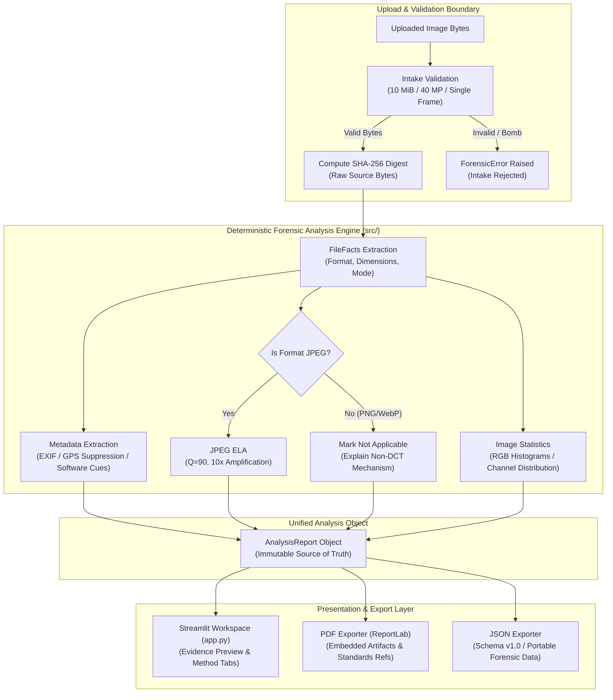

# 🛡️ AegisImage — Digital Image Forensics Toolkit

[](https://www.python.org/)
[](https://streamlit.io/)
[](tests/)
[](LICENSE)
[](docs/rules.md)

> **A local-first, explainable digital image forensics toolkit engineered for evidence integrity inspection, JPEG Error Level Analysis (ELA), metadata analysis, color channel statistics, and forensic-style reporting.**

---

## 📌 Problem Statement & Forensic Philosophy

Forensic image analysis tools frequently reduce complex image properties to arbitrary, uncalibrated "authenticity scores" or dramatic visual overlays without disclosing underlying mechanics, limitations, or empirical boundaries.

**AegisImage** is an **educational forensic workbench and analysis aid**. It is built on three core forensic principles:
1. **Cryptographic Immutability:** The raw uploaded byte stream is hashed using SHA-256 *before* any decoding or conversion. The original byte sequence remains unchanged in memory throughout the session.
2. **Exploratory Cues over Binary Verdicts:** In accordance with forensic science guidelines (SWGDE / NIST), AegisImage **never** emits definitive "fake," "real," or "forged" verdicts from heuristics alone. It isolates observations, provides contextual review cues, and explicitly documents method limitations.
3. **Strict Location Privacy:** EXIF GPS coordinates (`GPSLatitude` / `GPSLongitude`) are **suppressed by default** in both user interfaces and exported reports to prevent unauthorized location exposure.

---

## ✨ Core Features

| Feature | Description | Implementation Module |
|---|---|---|
| 🔐 **SHA-256 Pre-Processing Identity** | Hashes exact raw file bytes prior to decompression; verifies byte-level chain of custody. | [`src/integrity.py`](src/integrity.py) |
| 🛡️ **Defensive Container Intake** | Enforces a strict 10 MiB limit, 40 MP decoded ceiling, single-frame policy, and Pillow decompression-bomb safeguards. | [`src/validation.py`](src/validation.py) |
| 📋 **Metadata Extraction & Privacy** | Extracts camera make/model, timestamps, software tags, and orientation. Suppresses GPS coordinates by default. | [`src/metadata.py`](src/metadata.py) |
| 🔍 **JPEG Error Level Analysis (ELA)** | Computes compression error across DCT blocks at Q=90 and 10× amplification. Safely excludes non-JPEG formats. | [`src/ela.py`](src/ela.py) |
| 📊 **RGB Histograms & Channel Statistics** | Generates 256-bin channel intensity distributions, dynamic range saturation cues, and per-channel summary statistics. | [`src/image_statistics.py`](src/image_statistics.py) |
| 📑 **Dual-Format Forensic Reports** | Generates pure in-memory PDF reports (with embedded derived visual artifacts) and versioned JSON data exports. | [`src/reporting.py`](src/reporting.py) |

---

## 🏗️ Architecture & Data Pipeline

AegisImage strictly separates the deterministic image-processing core in `src/` from the presentation layer in `app.py`.



---

## 🚀 Quickstart & Setup

### Prerequisites
- Python 3.11+
- Virtual environment tool (`venv`)

### 1. Clone & Set Up Environment
```bash
# Clone the repository
git clone https://github.com/your-username/AegisImage.git
cd AegisImage

# Create and activate virtual environment
python -m venv .venv

# Windows (PowerShell)
.\.venv\Scripts\Activate.ps1

# Linux / macOS
source .venv/bin/activate

# Install dependencies
pip install -r requirements.txt
```

### 2. Launch the Application
```bash
streamlit run app.py
```
Open your browser at `http://localhost:8501`.

---

## 🧪 Testing & Empirical Evaluation

AegisImage includes comprehensive automated unit tests, boundary validations, and an empirical evaluation runner across synthetic labelled fixtures.

### Run Unit & Integration Tests (58 Tests)
```bash
pytest
```

### Run Labelled Evaluation Suite
```bash
python scripts/run_evaluation.py
```

### Empirical Evaluation Benchmark Summary

Evaluated against 11 synthetic fixtures in [`sample_images/manifest.json`](sample_images/manifest.json):

| Metric | Target | Observed Outcome | Pass Rate |
|---|---:|---:|---:|
| **Total Test Samples** | 11 | 11 | **100%** |
| **Boundary Intake Rejections** | 3 (Oversized, Corrupt, Animated) | 3 Safely Rejected | **100%** |
| **Valid Format Intakes** | 8 (JPEG, PNG, WebP) | 8 Safely Accepted | **100%** |
| **Pre-Processing SHA-256 Match** | 8 | 8 Exact Matches | **100%** |
| **Default GPS Coordinate Suppression** | 8 | 8 Coordinates Suppressed | **100%** |
| **JPEG ELA Execution** | 6 | 6 Completed | **100%** |
| **Non-JPEG ELA Exclusion** | 2 (PNG, WebP) | 2 `not_applicable` | **100%** |
| **PDF Report Generation** | 8 | 8 Generated Successfully | **100%** |
| **JSON Schema v1.0 Validation** | 8 | 8 Validated Successfully | **100%** |

*Full evaluation methodology and per-sample logs are documented in [`docs/evaluation.md`](docs/evaluation.md).*

---

## 📖 Methodology & Limitations Summary

- **SHA-256 Invariance:** Verifies file integrity during the investigation session. It does *not* prove when an image was created or that it was never altered prior to upload.
- **EXIF Vulnerability:** EXIF metadata is fragile and easily stripped or edited by everyday applications. Absence of metadata is common on social media and is **never** treated as evidence of tampering.
- **ELA Behavior:** Error Level Analysis visualizes differential compression error. High-contrast edges, complex textures, and prior multi-generation saves naturally exhibit elevated error levels. It is an exploratory indicator, not an automated forgery classifier.
- **Scope:** Single-user, local-process operation. Does not perform reverse image search, facial recognition, or generative AI deepfake detection.

*Detailed methodological notes are available in [`docs/methodology.md`](docs/methodology.md) and [`docs/limitations.md`](docs/limitations.md).*

---

## 📚 Standards & Literature References

1. **Research Paper:** *Design and Implementation of Digital Image Tool for Forensic Analysis*, ResearchGate ([Link](https://www.researchgate.net/publication/337982446_DESIGN_AND_IMPLEMENTATION_OF_DIGITAL_IMAGE_TOOL_FOR_FORENSIC_ANALYSIS_ANALYSIS)).
2. **NIST:** *Digital Investigation Techniques Scientific Foundation Review*, NISTIR 8354 ([Link](https://www.nist.gov/publications/digital-investigation-techniques-nist-scientific-foundation-review)).
3. **SWGDE:** *Scientific Working Group on Digital Evidence: Guidelines for Forensic Image Analysis* ([Link](https://www.swgde.org/)).
4. **Krawetz, N.:** *A Picture's Worth... Digital Image Analysis and Error Level Analysis*, Hacker Factor Solutions (2007).

---

## 📄 License

This project is licensed under the terms of the **MIT License**. See [`LICENSE`](LICENSE) for details.
