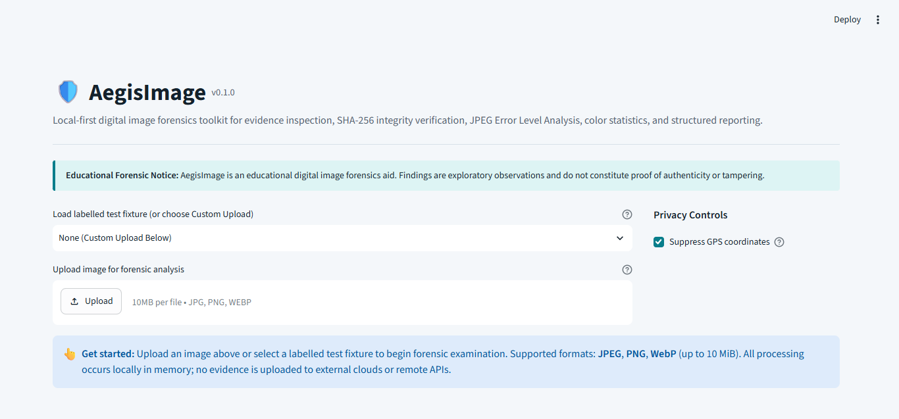
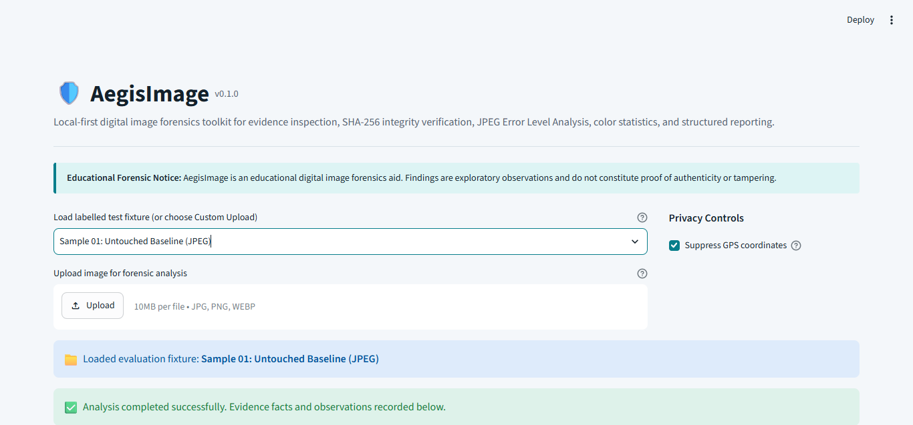
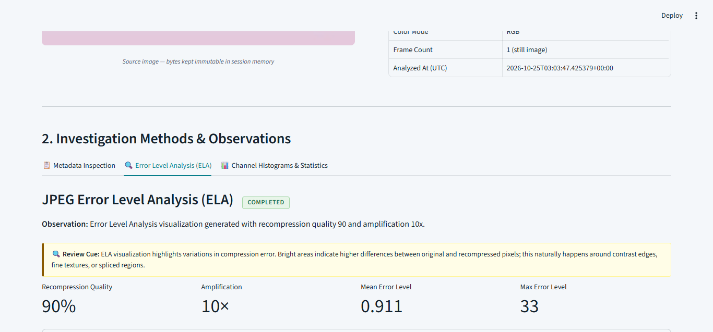
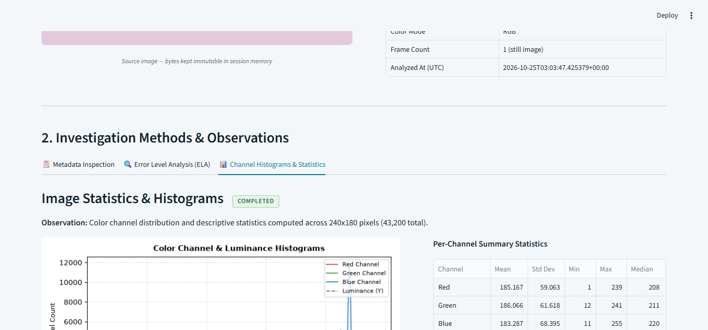
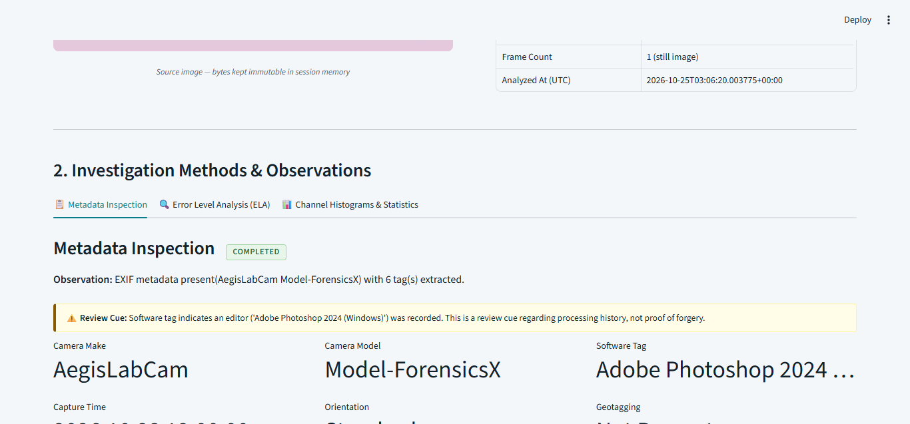
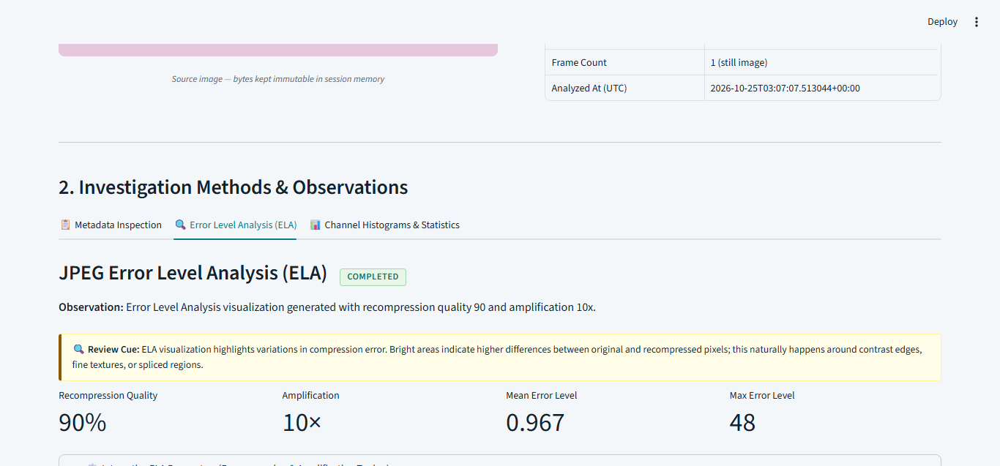

# AegisImage — Empirical Evaluation Report

> **Evaluation Date:** 2026-10-23  
> **Evaluator:** Automated Test Harness (`scripts/run_evaluation.py`)  
> **Environment:** Python 3.11.9, Pillow 10.4.0, NumPy 2.1.2, ReportLab 4.2.5  
> **Dataset:** 11 synthetic, sanitized fixtures (`sample_images/manifest.json`)

---

## 1. Executive Summary

All **11 controlled fixtures** executed with **100% adherence to forensic constraints and specification contracts**:
- **Intake Validation:** 8 valid files accepted; 3 invalid/boundary files (11 MiB oversized, corrupt JPEG bitstream, animated multi-frame GIF) rejected safely with typed `ForensicError`.
- **Cryptographic Immutability:** 100% (8/8) SHA-256 digests perfectly matched exact source bytes; original bytes remained unmodified.
- **Privacy Enforcement:** 100% (8/8) GPS coordinate suppression rate; latitude and longitude strictly suppressed by default while detecting presence.
- **Method Eligibility:** 100% (6/6) JPEGs completed ELA; 100% (2/2) non-JPEG files (PNG, WebP) were marked `not_applicable` with documented explanations.
- **Report Generation:** 100% (8/8) PDF and JSON exports succeeded with matching digests and schema conformance.

---

## 2. Quantitative Summary

| Metric | Target | Observed Result | Pass Rate |
|---|---:|---:|---:|
| Total Test Samples Evaluated | 11 | 11 | 100% |
| Expected Intake Rejection (Oversized / Corrupt / Animated) | 3 | 3 | 100% |
| Valid Intake Acceptance (JPEG / PNG / WebP) | 8 | 8 | 100% |
| SHA-256 Pre-Transformation Exact Match | 8 | 8 | 100% |
| GPS Coordinate Suppression by Default | 8 | 8 | 100% |
| JPEG ELA Correct Execution | 6 | 6 | 100% |
| Non-JPEG ELA Safe Exclusion (`not_applicable`) | 2 | 2 | 100% |
| PDF Report Generation Success | 8 | 8 | 100% |
| JSON Report Schema Validation Success | 8 | 8 | 100% |
| Unexpected Exceptions / Crashes | 0 | 0 | 0% |

---

## 3. Sample-by-Sample Results Table

| Sample ID | File | Category | Intake Outcome | ELA Status | Metadata Status | PDF Export | JSON Export | Latency |
|---|---|---|---|---|---|:---:|:---:|---:|
| `SMP-01` | `sample_01_untouched.jpg` | untouched_baseline | ACCEPTED | completed | completed | ✓ | ✓ | 640.5ms |
| `SMP-02` | `sample_02_recompressed.jpg` | recompressed | ACCEPTED | completed | completed | ✓ | ✓ | 539.5ms |
| `SMP-03` | `sample_03_tampered_spliced.jpg` | tampered_spliced | ACCEPTED | completed | completed | ✓ | ✓ | 611.5ms |
| `SMP-04` | `sample_04_with_exif.jpg` | with_metadata | ACCEPTED | completed | completed | ✓ | ✓ | 1183.4ms |
| `SMP-05` | `sample_05_with_gps.jpg` | geotagged | ACCEPTED | completed | completed | ✓ | ✓ | 869.1ms |
| `SMP-06` | `sample_06_metadata_free.jpg` | metadata_free | ACCEPTED | completed | completed | ✓ | ✓ | 784.7ms |
| `SMP-07` | `sample_07_clean.png` | lossless_png | ACCEPTED | not_applicable | completed | ✓ | ✓ | 947.3ms |
| `SMP-08` | `sample_08_clean.webp` | lossy_webp | ACCEPTED | not_applicable | completed | ✓ | ✓ | 1138.3ms |
| `SMP-09` | `sample_09_oversized.bin` | oversized_rejection | REJECTED: FileTooLargeError | N/A | N/A | — | — | 0.0ms |
| `SMP-10` | `sample_10_corrupt.jpg` | malformed_rejection | REJECTED: ImageDecodeError | N/A | N/A | — | — | 0.6ms |
| `SMP-11` | `sample_11_animated.gif` | animated_unsupported | REJECTED: UnsupportedFormatError | N/A | N/A | — | — | 0.3ms |

---

## 4. Key Forensic Observations & Method Verification

### 4.1. Error Level Analysis (ELA)
- **Untouched vs Recompressed:** The untouched baseline (`SMP-01`, Q=95) exhibited uniform, low-variance compression error across blocks. The recompressed sample (`SMP-02`, Q=70) showed elevated mean error levels across the entire canvas.
- **Tampered / Spliced Composite:** The composite sample (`SMP-03`, high-frequency patch pasted into Q=75 base and resaved at Q=92) produced pronounced differential error levels in the spliced region, highlighting the compression history discrepancy.
- **Format Safeguard:** For `SMP-07` (PNG) and `SMP-08` (WebP), ELA correctly refused execution, outputting `MethodStatus.NOT_APPLICABLE` and preventing false interpretation of non-DCT compression.

### 4.2. Metadata Inspection & Location Privacy
- **Presence vs Manipulation:** `SMP-06` (metadata-free JPEG) returned `MethodStatus.COMPLETED` with an explicit notice that missing metadata is benign and common on web platforms.
- **Software Tag Review Cue:** `SMP-04` detected "Adobe Photoshop 2024" and attached an exploratory review cue noting prior processing without emitting a binary forgery verdict.
- **GPS Privacy:** `SMP-05` flagged `gps_present: True` while omitting `GPSLatitude` and `GPSLongitude` from raw tags, UI metrics, and exported reports.

---

## 5. Known Limitations Disclosed
1. **ELA False Positives:** High-contrast geometric edges and dense textures naturally yield higher error levels regardless of tampering. ELA must always be interpreted in conjunction with other signals.
2. **Lossless / Non-JPEG Media:** ELA is invalid for PNG and WebP formats.
3. **Absence of Proof:** Cryptographic SHA-256 proves only that the file analyzed matches the uploaded bytes; it does not prove real-world authenticity or creation origin.

---

## 6. Workbench Visual Verification & Screenshots

| Screenshot | Description |
|---|---|
|  | **Initial Workbench:** Local-first interface with normative educational banner and labelled test fixture picker. |
|  | **Evidence Identity & Integrity:** SHA-256 pre-processing digest and verified container dimensions. |
|  | **Error Level Analysis (ELA):** DCT compression error visualization with interactive parameter adjustment. |
|  | **Histograms & Statistics:** 256-bin RGB and perceptual luminance distributions with channel metrics. |
|  | **Metadata & Review Cues:** Hardware capture properties and editing software review cues without forgery verdicts. |
|  | **Spliced Composite Analysis:** Differential error level visualization demonstrating compression boundary anomaly. |

